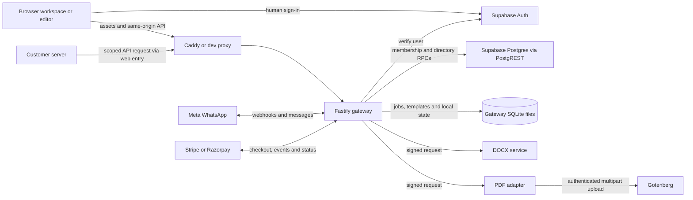

# Understanding DocuScripter end to end

DocuScripter turns a Word template and a set of text values into an editable document. An organization can keep approved templates, generate documents from a form or API, convert files to PDF, and retrieve the results. A training team can use the same machinery to issue a named certificate for each row in a roster. Someone who only needs to edit a Word file can open the local editor without creating an account.

Start with [one invoice moving through the system](#follow-one-invoice). Then follow the part you want to understand.

| Question | Where to go |
| --- | --- |
| What runs where, and which parts did the project implement? | [Components and responsibilities](#components-and-responsibilities) |
| How can one user belong to two organizations safely? | [Identity and organizations](#identity-and-organizations) |
| What does the editor save? How does preview work? | [Templates, versions, and preview](#templates-versions-and-preview) |
| What happens to a PDF request or a 100-row roster? | [Conversion and bulk generation](#conversion-and-bulk-generation) |
| How can another website or a WhatsApp sender use the service? | [API clients and WhatsApp](#api-clients-and-whatsapp) |
| How does a payment become a license? | [Billing and feature flags](#billing-and-feature-flags) |
| Where are the bytes, and what happens during a failure? | [Storage and recovery](#storage-and-recovery) |
| How do I run, debug, and prove these behaviors myself? | [Run and investigate](#run-and-investigate) |
| What can I confidently say about this product? | [Product boundaries](#product-boundaries) and [questions to practice](#questions-to-practice) |

## Follow one invoice

Open **Generate DOCX**, choose **Invoice**, and enter the invoice number, customer, description, and amount. Before pressing Generate you can see the values on the page. After pressing Generate the browser downloads a Word document and a new item appears in the organization's **Activity**. Those two renders have different effects on storage.

The following is a complete example of the JSON body for `POST /api/docx/generate`. These are illustrative field values. The built-in invoice defines exactly these four keys. Its amount is supplied as formatted text. Calculation, currency conversion, tax rules, and collection of the invoice amount belong to the calling application. The separate Stripe integration bills organizations for using DocuScripter. [Starter field definitions](../shared/starter-layouts.mjs)

```json
{
  "templateId": "invoice",
  "values": {
    "invoice_number": "INV-042",
    "customer_name": "Accounts Payable",
    "description": "Document preparation",
    "amount_due": "USD 125.00"
  }
}
```

1. **The browser builds the request.** `DocumentWorkflow` selects one source. A starter uses `templateId`, a saved template uses `savedTemplateId` with a version the form remembers, and an upload uses `filename` plus canonical base64 `file`. Each sends `values`. The workspace API helper supplies the signed-in user's bearer token and selected organization context. Caddy in Compose, or Vite in native development, forwards `/api/*` to the gateway. [Form](../frontend/src/workspace/DocumentWorkflow.tsx) · [Workspace API helper](../frontend/src/workspace/api.ts)
2. **The gateway decides who may run it.** It verifies a human bearer with Supabase, checks current membership of the selected tenant and requires a processing role. An API client takes a separate credential path and needs `documents:generate`. A saved-template request from a client also needs `templates:read`. Authorization begins before the upload is parsed. The gateway rechecks processing permission before dispatch. [Authorization](../backend/gateway/authorize-document-processing.mjs) · [Route registration](../backend/gateway/document-routes.mjs)
3. **The gateway admits the work.** `processing` checks per-tenant and whole-process concurrency. `beginJob` writes a tenant-scoped job in the `processing` state and accounts for up to 16 MiB of output before rendering. A SQLite write transaction makes the quota decision and reservation together, so simultaneous requests cannot both spend the same available capacity. [Job lifecycle and quota accounting](../backend/gateway/store.mjs)
4. **The private Word service receives a narrowly authorized request.** The gateway calls `POST /generate` with an HMAC-signed assertion covering the service audience, actor, tenant, method, path, JSON body digest, expiry, and one-time nonce. The DOCX service checks these with its own secret. Assertions expire after 30 seconds. A per-process nonce cache rejects replays during that window. The browser's Supabase credentials stay out of this hop. [Signing and verification](../backend/shared/service-authorization.mjs)
5. **The Word service produces real DOCX bytes.** For this invoice, `docx` builds the starter. For uploaded templates, the service first examines the Word package. A DOCX is a ZIP of XML parts, styles, relationships, and assets. The service opens the package with PizZip, inspects and fills the supported placeholders with Docxtemplater, then returns a compressed DOCX. Missing required fields in final generation produce a validation error. [Word service](../backend/docx/app.mjs) · [Starter construction](../backend/docx/starter-templates.mjs) · [Placeholder inspection](../backend/docx/template.mjs)
6. **The gateway commits and returns the same result.** It bounds the response size, checks the expected MIME type and file signature, and rechecks the caller's authority. On success it stores the bytes, marks the job `ready`, and returns an attachment with `X-Document-Id`. The browser downloads it immediately. A later `GET /api/jobs/:id/download` reads the stored artifact. A fresh render is unnecessary. If permission disappears during processing, the gateway discards the result and marks the reserved job `failed`. [Render, finish and download](../backend/gateway/document-routes.mjs)

An ordinary generation request is synchronous. The client waits for the bytes. The job ID ties the HTTP response to the durable history entry. If the final response gets lost, check Activity before resubmitting. The first request may already have committed a valid file, and another ordinary generation can create a second job. Bulk creation has its own idempotency mechanism.

## Components and responsibilities



The external webhook arrows show logical connections. Deployed callbacks enter through the public web ingress. In Compose, only the web port is published. The gateway and both document services share a private processing network. The PDF adapter also joins the renderer's private network. Supabase is deployed separately. [Compose topology](../compose.yaml)

| Component | What it owns | Start reading |
| --- | --- | --- |
| React and TypeScript workspace | Organization directory, role-aware navigation, generation and conversion forms, batch review, template library, Activity, admin, and billing. Search matches workspace pages and templates. Pins are local to the browser, user, and organization. | [Workspace shell](../frontend/src/workspace/Workspace.tsx) · [Organization context](../frontend/src/workspace/TenantContext.tsx) |
| Browser editor and preview | The editor library supplies Word editing/rendering. DocuScripter supplies the blank-document workflow, local open/download, authenticated template save, conflict handling, and a separate read-only viewer. | [Editor](../frontend/src/editor/DocxEditorPage.tsx) · [Preview entry](../frontend/src/preview/main.tsx) |
| Web entry and packaging | Vite builds three browser entry points. Caddy serves assets, applies page-specific content security policies and forwards API traffic. An optional Cloudflare Pages worker supports a frontend with a remote backend. | [Vite configuration](../frontend/vite.config.ts) · [Caddy](../infra/Caddyfile) · [Pages worker](../infra/cloudflare-pages-worker.mjs) |
| Identity and organization directory | Supabase Auth owns passwords, verification and sessions. PostgreSQL owns organizations, memberships, invitations and access events. SQL policies and functions enforce who can read or change them. | [Auth integration](../frontend/src/auth/supabase-auth.ts) · [SQL schema and permissions](../supabase/tenant-access.sql) |
| Fastify gateway | Public application API, verified tenant context, grants, rate limits, capacity, private service dispatch, authorization rechecks, and persistence. This is where the different front doors converge. | [Gateway composition](../backend/gateway/app.mjs) · [Document routes](../backend/gateway/document-routes.mjs) |
| Word engine | Builds four starter layouts, inspects DOCX fields, validates packages and renders text replacements. It can serve inspect, preview, and final-generation requests. | [Word app](../backend/docx/app.mjs) · [Word file validation](../backend/shared/word-file.mjs) |
| PDF adapter and renderer | The adapter validates the requested input and converts the internal JSON request to the renderer's multipart protocol. Gotenberg runs LibreOffice or Chromium to lay out pages. | [PDF app](../backend/pdf/app.mjs) · [Renderer configuration](../compose.yaml) |
| Persistence and bulk orchestration | Local SQLite stores durable artifacts, immutable past template revisions, credentials and job transitions. Batch code maps a roster into individually recoverable rows and outputs. | [Workspace store](../backend/gateway/store.mjs) · [Batch routes](../backend/gateway/batch-routes.mjs) · [Batch store](../backend/gateway/batch-store.mjs) |
| Optional integrations | Billing maps verified merchant state to organization capacity. WhatsApp maps authenticated messages to scoped application commands. Both run within the gateway deployment. | [Billing](../backend/billing/billing.mjs) · [WhatsApp webhook](../backend/whatsapp/webhook.mjs) |
| Shared contracts and tooling | `shared/` keeps starter fields, organization URLs, certificate rules, and filenames consistent across browser and server. `backend/shared/` contains server-only HTTP, signing, and file validation. Scripts start, build, and package the app. | [Shared modules](../shared/) · [Backend helpers](../backend/shared/) · [Scripts](../scripts/) · [Tests](../backend/tests/) |

When describing the engineering work, name the integration decisions you can demonstrate. For example, DocuScripter pins the version a user previewed, authorizes a private render, and rechecks membership before storing its output. Docxtemplater fills the Word fields. LibreOffice and Chromium handle page layout. Supabase verifies identity. The application is proprietary and keeps the libraries' notices. [Third-party inventory](../THIRD_PARTY_NOTICES.md)

## Identity and organizations

**An account identifies a person. A membership grants that person a role in one organization.** The same account can generate invoices in one organization and have read-only access in another. A workspace slug selects an address, a UUID identifies a tenant in storage, and a user or client ID identifies the actor. Knowing any of those IDs by itself grants no access.

1. The browser signs in with email and password through the Supabase SDK. Public registration requires email verification. The gateway asks Supabase's `/auth/v1/user` to verify the bearer, checks authenticated audience and a confirmed, nonanonymous user, then consults its own ended-session records. A successful password sign-in can open the workspace shell immediately. The browser revalidates existing sessions through `/api/auth/session`, and protected API requests enforce identity at the gateway. [Sign-in screen](../frontend/src/auth/SignInPage.tsx) · [Session handling](../frontend/src/auth/supabase-auth.ts)
2. The directory lists memberships. A human workspace request carries `X-Tenant-Id`. The gateway also takes the organization slug into account when present in the host or required by path routing. It queries membership through PostgREST with the user's own token and a publishable key. Supabase row-level security governs the directory; tenant-qualified SQLite queries govern document access. A member of organization A can pass the membership check for A, but a lookup for a file from B under A returns 404. Selecting B without membership instead fails with 403 before a file lookup. [Tenant authority](../backend/gateway/tenant-authority.mjs) · [Routing](../shared/organization-url.mjs)
3. In **subdomain mode**, the directory and organization have different browser origins. The organization tab keeps a random verifier locally and sends its hash and a state value to the directory. The gateway issues a one-use, 60-second handoff ticket after checking membership. The organization exchanges it with the verifier. The gateway verifies the target host and origin and checks membership again before returning session tokens in the response body. A gateway restart invalidates pending tickets. In **path mode**, `/org/<slug>` shares the directory origin and uses the existing browser session. [Handoff protocol](../backend/gateway/workspace-sessions.mjs) · [Browser side](../frontend/src/auth/workspace-sign-in.ts)
4. On logout the gateway records a digest of the verified subject and session identifier. For standard Supabase tokens with a session ID, refreshed tokens for that session are also rejected. A verified legacy bearer without a usable session ID is blocked by its exact token digest. A separate login on another device has its own session. Open tabs recheck access on focus, restoration, and periodically while visible. If the gateway cannot confirm logout, the UI reports the uncertainty. [Gateway session checks](../backend/gateway/authorize-document-processing.mjs) · [Organization session tests](../backend/tests/organizations.test.mjs)

| Human role | Typical authority inside that organization |
| --- | --- |
| Viewer | Browse and download shared templates and ready documents. Can also use the independent local editor. |
| Operator | Viewer access plus generation, conversion, bulk work, template creation, and permitted edits/deletions of their own records. |
| Admin | Operator access plus organization settings, invitations, non-owner membership management, API clients, WhatsApp configuration, and management of organization documents. |
| Owner | Administrative access plus ownership changes, billing, and explicit import of eligible personal records. |

Creating an organization grants its creator the first owner membership. Renaming the organization preserves its slug. An invitation is attached to an exact verified email address, expires after seven days and appears in the recipient's directory. DocuScripter provides in-app acceptance. Sending invitation email would require an additional delivery workflow. Role changes and removals pass through database functions, with locking and a last-owner safeguard. The access audit records membership and credential-management events. [Tenant routes](../backend/gateway/tenant-routes.mjs) · [Membership SQL](../supabase/tenant-access.sql) · [Database tests](../supabase/tests/tenant-access.test.sql)

## Templates, versions, and preview

**Local editing.** Opening `/editor.html` starts a blank document. The browser can also open a Word file up to 4 MiB. Edits live in the open editor until the user downloads or explicitly saves. A local download serializes the document on the device. Signing in adds a left panel populated by `GET /api/templates/mine`, filtered to the current user and organization. The workspace Templates page separately lists the organization's shared collection for use or download. An authorized API client can edit another creator's template even though that template does not appear in an administrator’s personal editor list. Reloading a local unsaved draft can lose edits. [Editor page](../frontend/src/editor/DocxEditorPage.tsx) · [Library hook](../frontend/src/editor/useEditorLibrary.ts)

**Reusable templates.** `POST /api/templates` sends a name and Word file. The gateway asks the DOCX service to inspect the fields, rechecks authority, then stores the bytes and metadata at version 1. A field such as `{customer_name}` takes a string. The implementation supports up to 64 distinct fields, 1,024 placeholder occurrences, and 4,000 characters per value. Names begin with a letter and continue with letters, digits or underscores, with two reserved names excluded. Loops, conditional expressions and dynamic image modules are outside this template language. The four built-in starters are invoice, business letter, project brief, and certificate. They are built from code and do not create customer records. [Field contract](../backend/shared/document-http.mjs) · [Template parser](../backend/docx/template.mjs)

**Editing without overwriting a colleague.** Suppose the template creator opens version 3 in two browser tabs. The first tab saves version 4 against `baseVersion: 3`. The store archives version 3 and changes the head in one transaction. The second save against version 3 receives HTTP 409. Reopen version 4 to review the changes, or save a copy under a new ID. Name-only API changes can also create revisions. A template deletion removes the current template and its saved revisions. A previously generated output has its own job and bytes. [Revision implementation](../backend/gateway/store.mjs) · [Version tests](../backend/tests/template-versions.test.mjs)

**Live preview.** The form waits about 450 ms after an edit and cancels superseded browser requests. The preview endpoint runs the Word engine and sends actual DOCX bytes to a same-origin frame using the editor's view mode. Missing keys remain visible as placeholders. An explicitly supplied empty string renders blank. Final generation requires an entry for every field. The form pins the selected saved revision, so a library refresh does not silently switch the source under a half-completed form. Preview uses processing capacity but creates no Activity item. Printing a PDF later uses a different layout engine. [Live preview](../frontend/src/workspace/LiveDocxPreview.tsx) · [Read-only viewer](../frontend/src/preview/main.tsx) · [Preview tests](../backend/tests/preview.test.mjs)

## Conversion and bulk generation

**One conversion.** `POST /api/pdf/convert` accepts `filename` and base64 `file`. A DOCX goes to Gotenberg's LibreOffice route. A UTF-8 HTML or HTM file goes to its Chromium HTML route, using print backgrounds and CSS page size. The PDF adapter authenticates with a separate renderer password and validates the PDF signature. The gateway handles authorization, capacity, persistence and download as it does for generation. For an individual template-to-PDF workflow, first generate the DOCX, then convert the resulting file. The bulk PDF flow performs both steps for each row. [PDF adapter](../backend/pdf/app.mjs) · [Renderer integration test](../backend/tests/renderer.test.mjs)

The server checks both ZIP structure and Word content before accepting an uploaded DOCX. It bounds the package to 400 parts and 24 MiB expanded and rejects encrypted entries, macros and embedded objects. HTML should embed required assets. The API requires an uploaded file. It has no URL-to-PDF input. The supplied Compose renderer disables JavaScript, macros and remote resource access, so remote assets in an uploaded HTML file may be missing in the PDF. Word layout depends on the rendering engine and available fonts. [Package checks](../backend/shared/word-file.mjs) · [Renderer settings](../compose.yaml)

**One roster.** Consider a training coordinator issuing completion certificates. The browser parses UTF-8 CSV, maps columns to the template fields and previews filenames. The certificate starter requires a recipient, course, completion date, issuer and certificate ID, and checks ID uniqueness within the submitted roster. Leading zeros in IDs need to survive the spreadsheet export. The coordinator can generate the first real file, review its layout, then resume. [Roster rules](../shared/certificate-roster.mjs) · [Batch form](../frontend/src/workspace/BatchForm.tsx)

| Step | Durable effect and recovery |
| --- | --- |
| Create | `POST /api/batches` stores the submitting actor, tenant, format, selected source and mapped rows. A saved template's version is pinned. Reusing a creation idempotency key with the same request returns that run. Changing the payload under that key returns 409. |
| Advance | The browser or API client calls `POST /api/batches/:id/next?row=N`. The store claims the row and reserves its normal document job together. Only one row in that batch can be processing. Repeating an already-started row number cannot accidentally advance the next recipient. |
| Finish | A PDF row first renders a DOCX, then sends it to the PDF service. Finishing the job changes the row to ready or failed and clears its input values in the database. The output also appears in organization Activity. |
| Pause or restart | Closing the browser stops it from submitting further rows. An already submitted row can finish. On a gateway restart an interrupted row becomes failed and queued rows remain available to resume. Correct failed rows in a new run. Deleting the source template can prevent pending rows from rendering. |
| Collect | The ZIP contains currently available outputs and returns included/omitted counts. Roster and run history are scoped to the submitting actor and organization. The individual finished documents follow the broader organization Activity permissions. |

Each run takes 1–100 rows, with a 2 MiB input limit, up to 100 retained batches per organization, and 30-day batch retention. The archive route caps the combined file bytes at 32 MiB. Individual outputs have a 16 MiB ceiling. The intermediate Word file in a PDF batch must also fit the 4 MiB conversion input limit. Expiring or deleting a batch leaves its Activity artifacts available under the normal job rules. [Batch protocol and examples](bulk-generation.md) · [Row claiming and cleanup](../backend/gateway/batch-store.mjs)

## API clients and WhatsApp

### A customer integrates a website

An organization admin or owner creates an **API client** in Organization settings, chooses its scopes and receives a client ID and a one-time secret. The customer's **server** stores that secret and exchanges it using HTTP Basic at `POST /api/oauth/token` with a form body of `grant_type=client_credentials`. The response contains a 15-minute bearer token. The server can request a narrower set of scopes and reuse the token until near expiry. The gateway stores digests of high-entropy secrets and tokens. Rotation invalidates issued tokens while preserving the client's ID and ownership of its documents. Revocation ends access. A client is an organization principal with its own lifecycle. Removing the administrator who created it does not revoke it. [Credential exchange](../backend/gateway/client-routes.mjs) · [Credential formats](../backend/gateway/client-credentials.mjs)

| Customer system needs to… | Grant or contract |
| --- | --- |
| Generate a starter DOCX | `documents:generate` and the invoice JSON above. A saved source also requires `templates:read`. |
| Convert a file and retrieve its own result | `documents:convert`. A processing-only client can fetch its own matching result by ID. Listing shared organization history requires `documents:read`. |
| Create or update its own templates | `templates:write` for creation and permitted edits. Add `templates:read` to inspect metadata or download. Send the reviewed `baseVersion` on an edit. |
| Edit a template created in the UI by another person | Grant `templates:edit:organization`. Add `templates:read` when the client needs to fetch the current version. `PATCH /api/templates/:id` accepts a new name, a replacement DOCX, or both. A 409 requires review of the newer version. |
| Delete eligible artifacts | Separate `documents:delete` or `templates:delete` grants. Creator and tenant restrictions still apply. An organization-wide template edit grant alone cannot delete another user's template. |

The token fixes the organization. If the caller supplies an organization host, slug or tenant header, it must agree with the credential. The application's machine API covers document workflows. Human membership administration, creation of other API clients, and billing use their own human authorization checks. A runnable editing example obtains a token and calls the gateway from Node. [Client API setup, requests, and responses](client-api.md) · [Editing example](../examples/edit-template.mjs)

### An enrolled sender requests a PDF

1. An admin connects a business phone number, a Meta app, an enrolled sender list and an organization API client. There is also an operator-managed file configuration. For an organization-managed connection, the gateway encrypts credentials using AES-256-GCM. The selected client determines which documents the sender can act on. Several senders mapped to one client share that client's rights and record ownership. [Connection routes](../backend/whatsapp/connection-routes.mjs) · [Credential storage](../backend/whatsapp/connections.mjs)
2. The sender attaches a DOCX with the caption `pdf`. Meta delivers an HTTPS webhook. A GET challenge verifies the callback during setup. For a POST, the gateway verifies the signature over the raw request bytes, matches the business phone and enrolled sender, and admits eligible events to a durable inbox before acknowledging them. A repeated delivery has the same deduplication key. [Webhook](../backend/whatsapp/webhook.mjs) · [Inbox](../backend/whatsapp/inbox.mjs)
3. A worker running in the gateway retrieves the media from Meta and obtains a tenant-scoped token with `documents:convert`. It maps the chat command to the real PDF route using Fastify's in-process request interface. Authorization, rate limits, conversion and job storage are the same as for a customer's website. It then uploads the result to Meta, rechecks client access and sends the reply to the enrolled sender. Document bytes pass through Meta in this workflow. [Worker](../backend/whatsapp/worker.mjs) · [Meta adapter](../backend/whatsapp/meta.mjs)
4. The worker checkpoints execution and delivery. A known job can be downloaded again after a media upload failure. If a crash leaves an uncertain document mutation, it asks the sender to check the workspace. If a send may already have reached Meta, it suppresses a blind resend. Deduplication and checkpoints reduce duplicates, but a handset receipt or exactly-once delivery is outside the guarantee. [WhatsApp tests](../backend/tests/whatsapp.test.mjs)

The channel accepts a fixed command vocabulary for conversion, generation, saving, listing, downloading and permitted deletion. It has no free-form AI interpreter, visual Word editing session, or group administration interface. Connecting it requires Meta credentials, a registered number and a publicly reachable HTTPS callback. [Commands](../backend/whatsapp/commands.mjs) · [Integration setup](whatsapp.md)

## Billing and feature flags

Three decisions answer different questions. **A feature flag** decides whether a deployment offers an operation. **A role or scope** decides whether this caller may use it in this tenant. **A license** decides whether the organization has sufficient capacity. For example, an Ultimate viewer can read a document, but generating one requires a processing role. Purchasing Ultimate increases capacity. Deployment switches remain under the operator’s control.

| Default capacity | Self-hosted or Starter | Plus | Ultimate |
| --- | ---: | ---: | ---: |
| Document storage | 256 MiB | 1 GiB | 5 GiB |
| Saved templates | 100 | 250 | 1,000 |
| Retained jobs | 1,000 | 5,000 | 25,000 |

`BILLING_MODE=self-hosted` runs independently of a payment provider. In managed mode the gateway evaluates an active operator-assigned contract, then a verified paid subscription within its confirmed period, then Starter. Tier limits can be configured. Storage includes prior revisions, outputs, pending batch inputs, and in-flight reservations. Retained jobs measure the history the organization keeps. Deleting jobs frees capacity, so this count cannot be sold as a monthly generation meter. [License catalog](../backend/billing/catalog.mjs) · [License selection](../backend/billing/billing.mjs)

**From checkout to paid capacity**

1. An owner chooses Plus or Ultimate and a configured provider. The gateway reserves a checkout attempt for that tenant, binds its ID and tenant to the provider request, and creates a hosted checkout using server-configured recurring price or plan IDs. Price, currency and interval come from the merchant account. A tenant has at most one open attempt or subscription. [Billing routes](../backend/billing/routes.mjs) · [Attempt store](../backend/billing/store.mjs)
2. Stripe sends the owner back to the purchasing workspace. A successful return asks the gateway to refresh. Canceling offers a way to resume. With Razorpay the owner can check status from the workspace. A signed webhook can confirm payment even after the browser closes. Both paths read authoritative merchant state and verify its association with the local attempt before granting paid capacity. [Owner UI](../frontend/src/workspace/BillingPage.tsx) · [Provider adapters](../backend/billing/providers.mjs)
3. For Stripe, a paid invoice line must cover the matching subscription item, recognized price and current service period. An unbilled upgrade from Plus to Ultimate can retain verified Plus coverage. Razorpay also checks the subscription's paid invoice and covered period. Replayed webhook events are deduplicated. A checkout-creation timeout can leave a purchase at the provider, so recovery reconciles the original attempt before allowing another. [Billing recovery guide](billing.md#recover-an-interrupted-checkout) · [Signed checkout test](../backend/tests/stripe-checkout.test.mjs)

Both payment providers are off by default. Managed billing, the billing feature flag, an enabled provider, merchant credentials, mapped prices and a registered webhook are needed for online purchases. Disabling billing closes its routes and webhooks. Previously verified paid access runs to its confirmed expiry, and stopping future **charges** requires a change at the merchant. Merchant-side tasks include invoice administration, refunds, taxes, subscription changes and cancellation. [Operator setup](billing.md)

**Feature switches.** The gateway reads 11 booleans at startup, enforces them on the backend, and publishes the effective values at `GET /api/features`. The browser loads them before initializing identity or presenting tools. They cover human sign-in, API clients, WhatsApp, billing, batches, machine template editing, template versions, template deletion, live preview, organization creation and workspace rate limits. WhatsApp needs API clients. Machine editing needs API clients and versioning. Self-service organization creation needs human sign-in. `FEATURE_AUTH=true` is the default. Turning it off opens the local editor and disables human workspace access. Separately enabled machine APIs still require valid scoped credentials. Change the root environment, restart the gateway and reload the browser. [Flags and dependencies](../backend/gateway/features.mjs) · [All environment variable names](../README.md#deployment-feature-flags)

## Storage and recovery

| Data | Where it lives | What that means operationally |
| --- | --- | --- |
| Accounts, memberships, invitations, organization names and access events | Supabase Auth and PostgreSQL tables including `ds_tenants`, `ds_memberships`, `ds_invitations`, and `ds_audit_events` | Back up identity and directory data separately. The app queries them using the user's authority. An access audit is narrower than a log of every file read. |
| Jobs and generated files | `jobs` in the main gateway SQLite database | Each row has an actor, tenant, kind, status and metadata. A ready artifact is stored as a BLOB, the actual file bytes. History paginates in groups of 50. |
| Templates and older versions | `templates` and `template_versions` in the same database | The current head and past names, field lists and original Word bytes support conflict detection and reading a reviewed revision. Old personal records with no tenant remain quarantined until their creator explicitly imports them into an organization they own. |
| Batches and inputs | `batches` and `batch_rows` | A batch belongs to its tenant and actor. Each claimed row points to a normal job. A database trigger clears terminal row input as part of finishing the job. |
| Machine credentials, token digests, credential audits, ended sessions | Workspace SQLite tables | Rotation/revocation and ended-session records survive a normal gateway restart. Subdomain handoff tickets and in-flight concurrency counts are process-local. |
| Rate limits, billing and WhatsApp | Sibling files under `DATA_PATH`, including `.limits.sqlite`, managed `.billing.sqlite`, `.whatsapp`, and `.whatsapp-connections.sqlite` | Back up the whole data directory and the WhatsApp encryption key, supplied via configuration or its protected key file. Retain the contract license file separately when configured. Ordinary document BLOBs need encrypted host storage if encryption at rest is required. |
| Open local editor document and pinned template IDs | Editor memory, and browser-local preferences for pins | A downloaded copy survives closing the editor. Pins only influence the user's shelf on that browser. They grant no access. |

Native development defaults to `.data/workspace.sqlite`. Compose uses `/app/data/workspace.sqlite` on the `workspace-data` volume. SQLite uses a write-ahead log (WAL) and transactions. Its convenience here is that a job status, artifact and related row update can commit together on one machine. The cost is an explicit deployment constraint of **one gateway process per database on durable local storage**. A second gateway on its own volume would see different jobs, quotas and rate counters. A shared SQLite volume by itself would still leave handoff tickets, concurrency admission and worker coordination local to each process. [Workspace store](../backend/gateway/store.mjs) · [Deployment topology](../compose.yaml)

For backup or restore, stop the gateway and preserve the entire data directory, including any WAL files, integration state and key material. A copy of the main database from a running volume can omit committed work. Back up Supabase separately and preserve the mapping between tenant IDs in the two stores. Deletion removes API access to a record. Physical remnants in database pages and historical backups follow the operator's storage and retention procedures. [Backup procedure](../README.md#storage-and-operations)

**Rate, concurrency and storage each limit a different resource.** The gateway counts requests per source before authorization, then uses verified actor and tenant budgets, with separate write budgets. Counters are stored transactionally in a sibling SQLite database. A limited request returns 429 with `Retry-After`. The optional rate flag controls the workspace budgets. Source, token exchange, webhook and route-level caps still apply. Behind an ingress, configure trusted proxies so several customers do not unintentionally share the same source allowance. Independently, render admission defaults to two simultaneous operations per tenant and four per gateway. A tenant can therefore have storage left and still be asked to retry a busy request. [Rate defaults and proxy setup](rate-limits.md) · [Admission logic](../backend/gateway/document-routes.mjs)

## Run and investigate

Run the commands below from the repository root. For a fresh checkout use Node 24 or newer and `npm ci`. The local editor can be explored first. For saved data and processing, use a configured development organization. Set the browser's public Supabase origin/key, configure the three distinct server secrets in the root environment and apply the appropriate tenant schema to your own Supabase installation. Provider keys belong on the gateway. [First-run instructions](../README.md#run-the-full-workspace) · [Configuration template](../.env.example) · [Supabase setup](../supabase/README.md)

| Mode | Command or entry | What to expect |
| --- | --- | --- |
| Editor development | `npm run dev:web`, then `http://127.0.0.1:5173/editor.html` | Vite serves the frontend. Local editing and download work without a signed-in workspace. Saved organization workflows need a gateway. |
| Full native development | `npm run dev`, then `http://127.0.0.1:5173/` | The launcher starts or reuses gateway 4000, DOCX 4001 and PDF adapter 4002. PDF rendering also needs a reachable authenticated Gotenberg, normally on 3000 in native development. |
| Self-hosted Compose | `docker compose up --build -d`, then `http://localhost:4173/` | Caddy is the public application entry. Document backends stay private. External HTTPS, DNS and an independently configured identity service are deployment responsibilities. |
| Optional Pages preview | `npm run build:pages` plus the preview backend/tunnel procedure | Pages serves frontend assets and proxies API requests. The local backend and tunnel must remain available for server workflows. [Deployment guide](deployment.md) |

### Trace the invoice yourself

1. In a development organization where you can process documents, open browser Developer Tools → Network. Select **Invoice**, type a few values and inspect `POST /api/docx/preview`. Observe the partially filled Word document and the absence of a new Activity item. Use your own development data.
2. Fill all four fields from the example and select **Generate DOCX**. Inspect the generation request body, response content type, `Content-Disposition` and `X-Document-Id`. Treat bearer and session information visible in Developer Tools as credentials.
3. Open Activity and download the file again. The new request is a GET to the recorded job ID. The same file can be retrieved after a gateway restart when the database is preserved. To see that invariant without restarting your workspace, run its isolated regression test.

```sh
node --test --test-name-pattern='real DOCX generation persists bytes' backend/tests/workspace.test.mjs
```

4. Follow the same invoice through the server from `wordInput` into `generate`. After `store.beginJob`, `finishJob` calls `render`, which dispatches to the private `/generate` route. On return, `finishJob` rechecks permission and calls `store.completeJob`. For one variation, omit `customer_name` in an API request. Preview preserves the token. Final rendering rejects the missing field. [Sample and API setup](client-api.md) · [Preview tests](../backend/tests/preview.test.mjs)

### Investigate a symptom

| Observation | First place to look |
| --- | --- |
| Sign-in succeeds at the directory but the organization will not open | Check the selected slug, actual membership and allowed origin. In subdomain mode inspect the link/ticket exchange, host forwarding and expiry. A 401 points to identity or an ended session. A 403 can mean a valid user lacks membership or the needed role. |
| A file or optional route returns 404 | Compare the tenant and record ID, then read `/api/features`. A hidden route, a record in another organization and an unavailable artifact can all appear missing. |
| An upload fails with 400, 413 or 422 | Inspect the schema and file size, canonical base64, DOCX structure, and placeholder names. Final renders need all required fields. An unsupported extension or invalid Word package cannot be fixed by increasing concurrency. |
| A save or generation returns 409 | Read the message. A stale `baseVersion`, a conflicting batch idempotency key, and exhausted tenant capacity require different fixes. |
| A call returns 429 or 503 | Check `Retry-After`, the rate or concurrency limit and the health of the required dependency. Gateway `/api/health` reports liveness. PDF adapter `/health` checks its renderer. Missing identity configuration or tenant schema can also produce 503. |
| Word works but PDF fails with a gateway/upstream error | Inspect the PDF adapter, renderer health, renderer credentials, input type and timeouts. A good gateway health check alone proves little about conversion. Private service logs record routes and status without needing document contents. |
| A paid customer still sees Starter | Check the tenant, active contract or checkout attempt, provider enablement, webhook verification, and paid service period. The owner's **Check payment status** reconciles with the provider. |

### What the tests prove

```sh
npm run check
node --test backend/tests/tenants.test.mjs backend/tests/template-versions.test.mjs
node --test backend/tests/batches.test.mjs backend/tests/stripe-checkout.test.mjs
```

`npm run check` runs the Node test suite followed by the TypeScript/Vite production build. Tests use temporary state, real gateway route handlers and actual DOCX generation. The identity, directory, merchant and Meta endpoints are simulated where the tests supply adapters. These tests can exercise revocation during a render, conflicting saves, duplicate delivery or a payment provider outage without touching a customer's organization. [Test fixtures](../backend/tests/helpers.mjs) · [Template version conflicts](../backend/tests/template-versions.test.mjs) · [Rate limits](../backend/tests/rate-limits.test.mjs)

The real Gotenberg integration runs when `GOTENBERG_TEST_URL` and `GOTENBERG_TEST_PASSWORD` refer to an authenticated test renderer. It checks HTML and Word conversion, access control and a PDF batch. The CI workflow also provisions a disposable PostgreSQL database to run tenant SQL/RLS tests, builds the Pages artifact, and validates Compose configuration. A passing Node suite alone cannot establish that a merchant account, live WhatsApp phone, published domain or production backup is configured correctly. [Renderer test](../backend/tests/renderer.test.mjs) · [CI workflow](../.github/workflows/check.yml)

## Product boundaries

| Area | What you can demonstrate | Current boundary |
| --- | --- | --- |
| Document authoring | Local Word editing, reusable text-token templates, version history, real DOCX preview and PDF output | No collaborative co-editing, approval/signature workflow, OCR, general PDF editor, or guarantee of exact layout parity with desktop Word. |
| Tenancy and identity | Shared application with logically isolated organizations, live membership checks, four roles, invitations, and scoped API clients | No per-customer database provisioning, custom role designer, per-document sharing ACLs, or application-provided enterprise SSO/SCIM onboarding. |
| Bulk certificates | CSV mapping, duplicate ID checks within a roster, named files, first-file review, resumable batches and ZIP download | No unattended general batch scheduler, automatic email/LMS delivery, or public certificate verification/revocation registry. |
| Billing | Organization-level capacities, contract licenses and optional hosted subscription checkout | No seat billing, monthly usage metering, overage charging, or in-app invoice/refund management. |
| Availability and operations | Durable local history, startup recovery, tenant quotas, rate limits, health checks and scoped access logs | A single gateway owns its database. Multi-region failover, distributed job queues, automated off-site backup and production SLA/compliance certification are outside the shipped system. |

For example, supporting multiple active gateways would require a shared source of truth for jobs and credentials, shared admission and rate counters, coordination for handoff tickets and workers, and a way to store artifacts across hosts. Moving file bytes to object storage would also require defining what happens when an upload succeeds but a database commit fails. These are design considerations for a future deployment. [Current storage model](../backend/gateway/store.mjs) · [Deployment discussion](deployment.md)

## Questions to practice

| Question | What a good answer explains |
| --- | --- |
| Why do we need a gateway if Supabase already authenticates people? | Identity supplies a verified subject. The gateway combines it with tenant membership or machine scopes, admits work within limits, signs a request to a private service, then saves the authorized result. |
| An admin removes an operator while a large file is rendering. Who gets the file? | The post-render permission check runs before persistence and delivery. The reserved job fails and its output is discarded. |
| Two users save over version 3. Which edit survives? | The first valid transaction advances the head to 4. Optimistic concurrency rejects the stale save with 409. The second user must review the new head or create a copy. |
| Is a completed payment redirect enough to unlock Ultimate? | The return starts reconciliation. The gateway needs tenant-bound, verified merchant evidence for the paid plan and period. |
| Which operations continue when the user closes the browser? | An admitted document request can finish. Bulk submission of further rows needs a caller. The WhatsApp inbox worker runs in the gateway. A signed payment webhook can reconcile without a browser. |
| What did DocuScripter implement around the open-source engines? | Trace the organization-aware form, permission model, service assertions, revision pinning, durable artifact storage and recovery. Identify the library or service performing identity verification, DOCX substitution and PDF layout at each point. |
